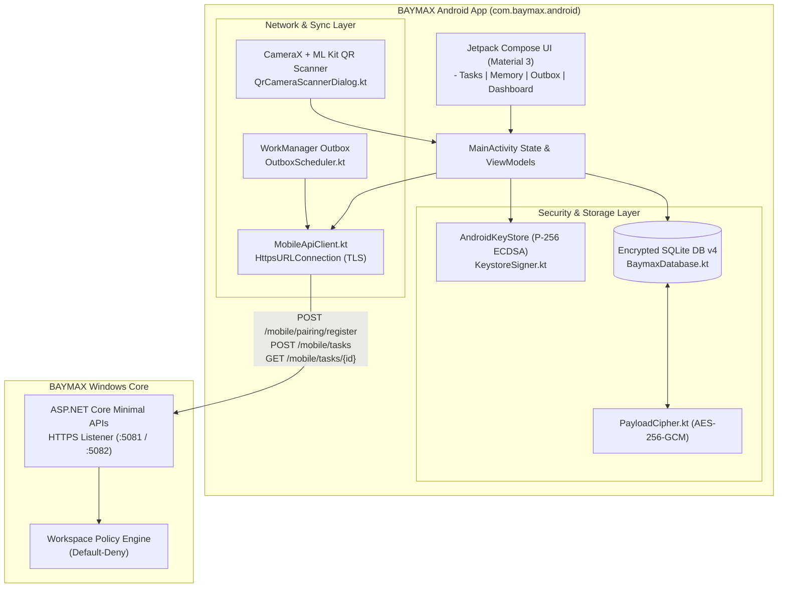

# BAYMAX Companion Node (Android)

[](https://developer.android.com)
[](https://kotlinlang.org)
[](https://developer.android.com/jetpack/compose)
[](#security--cryptography)
[](LICENSE)

An enterprise-grade, local-first Android node and remote control surface for the **BAYMAX Windows Core**. Built with modern **Kotlin**, **Jetpack Compose (Material 3)**, and **Android Hardware Security**, this companion application allows users to issue natural language tasks, manage cross-device memory context, inspect local outbox events, and pair with Windows hosts via live CameraX QR scanning over private local networks.

---

## 📌 Overview

The **BAYMAX Companion App** (`com.baymax.android`) acts as a secure mobile client and local-first resilient node within the BAYMAX ecosystem. 

Unlike traditional cloud-dependent mobile remotes, BAYMAX operates **local-first** over LAN / WireGuard P2P tunnels. The Windows Core remains authoritative for execution policies and workspace safety boundaries, while the Android node manages hardware-bound cryptographic identities, persistent memory tiers ($T_0, T_1, T_2$), and model context handoffs when LLM token thresholds ($90\%$) are reached.

---

## ✨ Features

- **🚀 1-Click Remote Task Dispatch**: Submit natural language file and system commands directly to Windows Core (`POST /mobile/tasks`).
- **📷 CameraX + ML Kit Live QR Scanner**: Fast, live camera modal to scan Windows host QR invitation payloads (`{"version":1, "endpoint":"https://...", ...}`) or `baymax://pair` URIs.
- **🛡️ Hardware Cryptography & Signatures**:
  - **AndroidKeyStore P-256 ECDSA** key generation.
  - Canonical `BAYMAX-PAIRING-REGISTRATION-V1` signature generation.
  - Canonical `BAYMAX-MOBILE-REQUEST-V1` HTTP request authentication headers (`X-Baymax-Signature`, `X-Baymax-Nonce`, `X-Baymax-Timestamp`, `X-Baymax-Device-Id`).
- **🔒 AES-256-GCM Local Database Storage**: Encrypted SQLite storage v4 (`baymax_local.db`) for events, memories, checkpoints, and paired devices.
- **⏱️ Live Asynchronous Status Polling**: Real-time HTTP polling loop (`GET /mobile/tasks/{taskId}`) updates task cards from `QUEUED` $\rightarrow$ `RUNNING` $\rightarrow$ `COMPLETED` / `FAILED`.
- **🧠 Cross-Device Persistent Memory & Context Handoff**:
  - Multi-tier memory browser ($T_0$ User Confirmed, $T_1$ System Derived, $T_2$ Untrusted Evidence).
  - Context Handoff Engine triggers zero-loss Context Pack generation when LLM token consumption hits $90\%$.
- **📡 Offline Outbox Resiliency**: Automatic task and event queuing via Android **WorkManager** when network connectivity is lost.

---

## 📐 Architecture

The application follows clean architecture principles with MVVM state flow and local-first data persistence:



---

## 🛠️ Tech Stack

| Domain | Technology / Library |
| :--- | :--- |
| **Language** | Kotlin 1.9.0 (JVM target 17 / SDK 37) |
| **UI Framework** | Jetpack Compose (Material 3, Navigation, Runtime, Foundation) |
| **Security & Cryptography** | `AndroidKeyStore`, P-256 ECDSA (`SHA256withECDSA`), `javax.crypto.Cipher` (AES-256-GCM) |
| **Database** | SQLite Android (`SQLiteOpenHelper` v4) |
| **Networking** | `java.net.HttpsURLConnection`, JSON (`org.json`), TLS Certificate Pinning |
| **Camera & Scanning** | CameraX (`camera2`, `lifecycle`, `view`), Google ML Kit Barcode Scanning |
| **Background Sync** | Android WorkManager (`androidx.work:work-runtime-ktx`) |
| **Testing** | JUnit 4, Mockito Kotlin |

---

## 📂 Folder Structure

```text
com.baymax.android/
├── core/
│   ├── capabilities/      # Capability registry and approval models
│   ├── memory/            # Persistent memory store (T0, T1, T2 tiers)
│   ├── network/           # MobileApiClient, WireGuard config, QR payload parser
│   ├── security/          # KeystoreSigner (ECDSA P-256), PayloadCipher (AES-256-GCM)
│   ├── storage/           # BaymaxDatabase (DB v4), ReadCache, DevicePreferences
│   ├── sync/              # OutboxSyncProcessor, WorkManager OutboxScheduler
│   └── task/              # TaskContextHandoffManager & checkpoint models
├── data/
│   ├── pairing/           # PairingRepository (Registration & polling loop)
│   ├── permissions/       # CapabilityGrant repository
│   ├── plans/             # ImmutablePlanRepository & ECDSA approval signing
│   └── tasks/             # TaskRepository (13-stage task lifecycle)
└── ui/
    ├── navigation/        # NavTab enumeration & navigation routes
    └── screens/           # Jetpack Compose UI Screens
        ├── DashboardScreen.kt          # Windows connection & scanner launcher
        ├── EventsScreen.kt             # Outbox event inspector
        ├── MemoryAndHandoffScreen.kt   # Memory browser & context handoff
        ├── QrCameraScannerDialog.kt    # CameraX + ML Kit QR scanning modal
        └── TaskComposerScreen.kt       # 1-Click remote task remote
```

---

## 🚀 Installation and Setup Guide

### Prerequisites

- **Android Studio**: Jellyfish | 2024.1.1 or newer.
- **JDK**: JDK 17 configured in Android Studio.
- **Android Device / Emulator**: Android 8.0+ (API level 26 or higher).
- **Physical Device Recommendation**: Attached device via ADB with Camera permission for QR scanning.

### Step 1: Clone the Repository

```bash
git clone https://github.com/your-username/baymax-android.git
cd baymax-android
```

### Step 2: Open in Android Studio & Gradle Sync

1. Open Android Studio and choose **Open an Existing Project**.
2. Select the `BAYMAX` root folder.
3. Allow Gradle to download dependencies and perform a sync.

### Step 3: Run Unit Tests

Verify that all 14 hardware security, payload parsing, and unit tests pass:

```bash
./gradlew app:testDebugUnitTest
```

### Step 4: Build & Install on Device

Connect your Android phone via USB debugging and execute:

```bash
./gradlew app:installDebug
```

---

## 💻 Usage

### 1. Pairing with Windows PC

1. Launch **BAYMAX Windows AgentHost** on your PC.
2. Click **Pair Mobile Device** to generate a 60-second QR code.
3. Open the Android app, go to **Node Dashboard** (`📡`), and tap **📷 Scan QR Code with Camera**.
4. Scan the QR code. The app sends `POST /mobile/pairing/register` and updates status to:
   > `PAIRING SENT: Waiting for Windows confirmation...`
5. On Windows PC, click **Confirm pairing**. The Android app updates to green **`PAIRED & CONNECTED`**!

### 2. Submitting Remote Tasks

1. Go to the **Tasks** tab (`🤖`).
2. Type a command (e.g., *"create text file with text Happy Birthday"*) or tap a preset chip (*"Create File"*).
3. Tap **🚀 Submit Remote Task to Windows**.
4. Watch the task card update live:
   - 🟠 **`QUEUED`**: Submitted and accepted by Windows.
   - 🔵 **`RUNNING`**: Windows AgentHost executing steps.
   - 🟢 **`COMPLETED`**: Execution finished successfully.

---

## 📄 MIT License

```text
MIT License

Copyright (c) 2026 BAYMAX Project

Permission is hereby granted, free of charge, to any person obtaining a copy
of this software and associated documentation files (the "Software"), to deal
in the Software without restriction, including without limitation the rights
to use, copy, modify, merge, publish, distribute, sublicense, and/or sell
copies of the Software, and to permit persons to whom the Software is
furnished to do so, subject to the following conditions:

The above copyright notice and this permission notice shall be included in all
copies or substantial portions of the Software.

THE SOFTWARE IS PROVIDED "AS IS", WITHOUT WARRANTY OF ANY KIND, EXPRESS OR
IMPLIED, INCLUDING BUT NOT LIMITED TO THE WARRANTIES OF MERCHANTABILITY,
FITNESS FOR A PARTICULAR PURPOSE AND NONINFRINGEMENT. IN NO EVENT SHALL THE
AUTHORS OR COPYRIGHT HOLDERS BE LIABLE FOR ANY CLAIM, DAMAGES OR OTHER
LIABILITY, WHETHER IN AN ACTION OF CONTRACT, TORT OR OTHERWISE, ARISING FROM,
OUT OF OR IN CONNECTION WITH THE SOFTWARE OR THE USE OR OTHER DEALINGS IN THE
SOFTWARE.
```
